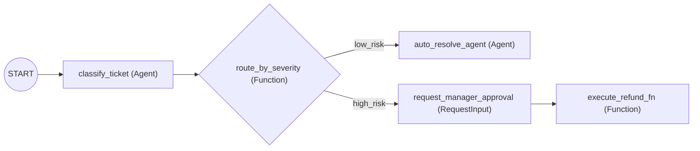

# ADK 2.0 Graph Workflows, Human-in-the-Loop (HITL) & Pause/Resume

Real-world enterprise PoCs (fintech, healthcare, supply chain, cloud ops) rarely rely on a single free-form prompt loop. They require **deterministic conditional routing**, **mixed code + LLM execution nodes**, and **Human-in-the-Loop (HITL) approval gates** before executing high-stakes actions.

**Official Documentation:** [ADK 2.0 Graph Workflows](https://adk.dev/graphs/) · [Graph Routes](https://adk.dev/graphs/routes/) · [Human Input Nodes](https://adk.dev/graphs/human-input/) · [Tool Action Confirmations](https://adk.dev/tools-custom/confirmation/) · [Resume Stopped Agents](https://adk.dev/runtime/resume/)

---

## 1. Declarative Graph-Based Workflows (`Workflow` & Conditional `edges`)

Introduced in [ADK 2.0](https://adk.dev/2.0/), the `Workflow` class lets you wire together **Python functions**, **`Agent` nodes**, and **human input nodes** into an explicit directed graph with conditional branching:



```python
from google.adk import Agent, Workflow
from google.adk.events import RequestInput
from pydantic import BaseModel


class TicketClassification(BaseModel):
    category: str
    amount_usd: float
    summary: str


classify_ticket = Agent(
    name="classify_ticket",
    model="gemini-3.8-flash",
    instruction="Extract the refund category, USD amount, and summary from the user request.",
    output_schema=TicketClassification,
)


def route_by_risk(ticket: TicketClassification) -> str:
    """Deterministic Python router — zero LLM latency or hallucination risk."""
    if ticket.amount_usd >= 500.0:
        return "needs_human_approval"
    return "auto_approve"


def request_manager_approval(ticket: TicketClassification):
    """Pauses the graph deterministically until a human replies (yes/no)."""
    yield RequestInput(
        message=f"Approve refund of ${ticket.amount_usd:.2f} for '{ticket.summary}'? (yes/no)"
    )


def process_approval_decision(human_reply: str) -> str:
    if str(human_reply).strip().lower().startswith("y"):
        return "Refund approved by manager and executed."
    return "Refund rejected by manager."


auto_approve_agent = Agent(
    name="auto_approve_agent",
    model="gemini-3.8-flash",
    instruction="Confirm that the refund under $500 has been automatically processed.",
)

root_agent = Workflow(
    name="refund_approval_workflow",
    edges=[
        ("START", classify_ticket, route_by_risk),
        (
            route_by_risk,
            {
                "auto_approve": auto_approve_agent,
                "needs_human_approval": request_manager_approval,
            },
        ),
        (request_manager_approval, process_approval_decision),
    ],
)
```

---

## 2. Tool-Level Action Confirmations (`require_confirmation=True`)

When using a standard [`LlmAgent`](agent_development_kit_adk_and_skills.md) (without building a full graph), you can gate any sensitive tool behind an automatic **Human Confirmation prompt** ([Official Guide](https://adk.dev/tools-custom/confirmation/)) by setting `require_confirmation=True` on `FunctionTool`:

```python
from google.adk import Agent
from google.adk.tools import FunctionTool


def delete_production_dataset(dataset_id: str, reason: str) -> dict:
    """Permanently deletes a BigQuery dataset after human confirmation."""
    return {"status": "deleted", "dataset_id": dataset_id, "reason": reason}


root_agent = Agent(
    name="data_governance_agent",
    model="gemini-3.8-flash",
    instruction="Help users manage datasets. Destructive actions require confirmation.",
    tools=[
        FunctionTool(delete_production_dataset, require_confirmation=True),
    ],
)
```
When tested in `adk web` or via an [AG-UI / REST frontend](agent_frontend_streaming_ag_ui.md), ADK automatically pauses before executing `delete_production_dataset` and renders a confirmation dialog for the user.

---

## 3. Resumable Agent Workflows (`ResumabilityConfig`)

To ensure long-running workflows, human-approval pauses, or network-interrupted runs can resume from their exact checkpoint without restarting from step 1 ([Official Guide](https://adk.dev/runtime/resume/)), wrap your `root_agent` in an `App` with `ResumabilityConfig(is_resumable=True)`:

```python
from google.adk.apps import App, ResumabilityConfig

app = App(
    name="resumable_enterprise_poc",
    root_agent=root_agent,
    resumability_config=ResumabilityConfig(is_resumable=True),
)
```

Resume an interrupted or paused invocation over the [ADK API Server](agent_frontend_streaming_ag_ui.md) by passing its `invocation_id`:
```bash
curl -X POST http://localhost:8000/run_sse \
  -H "Content-Type: application/json" \
  -d '{
    "app_name": "resumable_enterprise_poc",
    "user_id": "user_123",
    "session_id": "session_abc",
    "invocation_id": "invocation-uuid-from-event-log"
  }'
```

---

## Related Concepts

- [Agent Development Kit (ADK 2.0) & Official Skills](agent_development_kit_adk_and_skills.md) — Core ADK 2.0 concepts, `SequentialAgent`, `ParallelAgent`, and `SkillToolset`.
- [Custom Frontend UI & Real-Time Agent Streaming](agent_frontend_streaming_ag_ui.md) — Rendering live graph events, tool calls, and HITL prompts in React/Next.js.
- [One-Command PoC Scaffolding: Agents CLI & Templates](poc_scaffolding_agents_cli_and_templates.md) — Bootstrapping and deploying ADK 2.0 projects.
