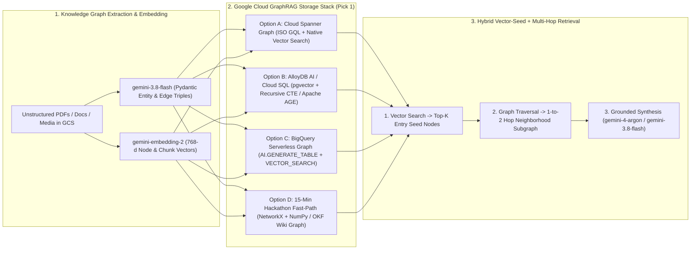

# How to Build GraphRAGs on Google Cloud

Standard vector RAG retrieves isolated chunks that match a query's cosine similarity, which often fails on **multi-hop reasoning** (e.g., *"Which customer workloads are impacted if microservice X's database certificate expires?"*). **GraphRAG** solves this by combining **semantic vector search** ([`gemini-embedding-2`](gemini_embedding_2_multimodal.md)) to locate entry-point seed nodes with **knowledge graph traversal** ($1\text{–}3$ hops along typed edges) to assemble connected relational context before synthesis by [`gemini-4-argon` or `gemini-3.8-flash`](agent_platform_models.md).

---

## 1. End-to-End GraphRAG Pipeline on Google Cloud



---

## 2. Step 1: Extract Entities & Relationships with `gemini-3.8-flash`

Use [`gemini-3.8-flash`](agent_platform_models.md) with Pydantic structured outputs ([Google GenAI SDK](google_genai_sdk_vertex.md)) to turn unstructured documents, PDFs, or transcripts into normalized graph nodes and edges:

```python
from google import genai
from google.genai import types
from pydantic import BaseModel, Field

class GraphNode(BaseModel):
    node_id: str = Field(description="Canonical snake_case identifier, e.g. 'payment_service'")
    label: str = Field(description="Entity type, e.g. 'Service', 'Database', 'Team', 'Policy'")
    name: str
    summary: str = Field(description="1-2 sentence description of this entity and its attributes")

class GraphEdge(BaseModel):
    source_id: str
    target_id: str
    relationship: str = Field(description="UPPER_SNAKE_CASE verb, e.g. 'DEPENDS_ON', 'OWNED_BY'")
    evidence: str = Field(description="Brief quote or explanation supporting this relationship")

class KnowledgeGraphDelta(BaseModel):
    nodes: list[GraphNode]
    edges: list[GraphEdge]

client = genai.Client(vertexai=True, project="your-hackathon-project-id", location="global")

def extract_graph_from_text(doc_text: str) -> KnowledgeGraphDelta:
    resp = client.models.generate_content(
        model="gemini-3.8-flash",
        contents=f"Extract all technical entities and directed relationships from:\n\n{doc_text}",
        config=types.GenerateContentConfig(
            response_mime_type="application/json",
            response_schema=KnowledgeGraphDelta,
            thinking_config=types.ThinkingConfig(thinking_level="LOW"),
            temperature=0.0,
        ),
    )
    return resp.parsed
```

Next, embed each `GraphNode.summary` (and any multimodal diagram/PDF attachments) into a 768-dimensional vector using [`gemini-embedding-2`](gemini_embedding_2_multimodal.md).

---

## 3. Step 2: Choose Your Google Cloud GraphRAG Storage Architecture

### Option A: Cloud Spanner Graph + Vector Search (Enterprise Zero-ETL Multi-Model)
- **Official Docs:** [Spanner Graph Overview](https://docs.cloud.google.com/spanner/docs/graph/overview) · [Spanner Graph Setup](https://docs.cloud.google.com/spanner/docs/graph/set-up)
- **Why Choose It:** Combines relational tables, an **ISO GQL Property Graph (`CREATE PROPERTY GRAPH`)**, and **exact/approximate vector search (`COSINE_DISTANCE` / `APPROX_COSINE_DISTANCE`)** inside a single database—eliminating synchronization between a separate vector DB and graph DB.
- **Schema & Hybrid Vector-Graph Query Example (GoogleSQL + GQL):**
  ```sql
  -- 1. Create Node and Edge tables with a 768-d vector column
  CREATE TABLE GraphNodes (
    node_id STRING(128) NOT NULL,
    label STRING(64),
    name STRING(256),
    summary STRING(MAX),
    embedding ARRAY<FLOAT32>(vector_length=>768)
  ) PRIMARY KEY (node_id);

  CREATE TABLE GraphEdges (
    source_id STRING(128) NOT NULL,
    target_id STRING(128) NOT NULL,
    relationship STRING(64) NOT NULL,
    evidence STRING(MAX),
    FOREIGN KEY (source_id) REFERENCES GraphNodes (node_id),
    FOREIGN KEY (target_id) REFERENCES GraphNodes (node_id)
  ) PRIMARY KEY (source_id, target_id, relationship);

  -- 2. Define the Property Graph view
  CREATE OR REPLACE PROPERTY GRAPH HackathonKnowledgeGraph
    NODE TABLES (GraphNodes KEY (node_id) LABEL Entity PROPERTIES (node_id, label, name, summary, embedding))
    EDGE TABLES (
      GraphEdges KEY (source_id, target_id, relationship)
      SOURCE KEY (source_id) REFERENCES GraphNodes (node_id)
      DESTINATION KEY (target_id) REFERENCES GraphNodes (node_id)
      LABEL RELATED_TO PROPERTIES (relationship, evidence)
    );

  -- 3. Hybrid GraphRAG Query: Find Top-3 Vector Seed Nodes -> Traverse 1-2 Hops in GQL
  WITH SeedNodes AS (
    SELECT node_id, COSINE_DISTANCE(embedding, @query_vector) AS distance
    FROM GraphNodes
    WHERE embedding IS NOT NULL
    ORDER BY distance ASC
    LIMIT 3
  )
  SELECT
    seed_id,
    hop1_rel,
    neighbor_name,
    neighbor_summary
  FROM SeedNodes
  JOIN GRAPH_TABLE (
    HackathonKnowledgeGraph
    MATCH (s:Entity)-[r:RELATED_TO]->{1,2}(n:Entity)
    RETURN s.node_id AS seed_id, r.relationship AS hop1_rel, n.name AS neighbor_name, n.summary AS neighbor_summary
  ) USING (seed_id);
  ```

---

### Option B: AlloyDB AI or Cloud SQL for PostgreSQL (`pgvector` + Recursive CTE / Apache AGE)
- **Official Docs:** [AlloyDB AI](https://docs.cloud.google.com/alloydb/docs/ai) · [Cloud SQL Vector Embeddings](https://docs.cloud.google.com/sql/docs/postgres/generate-manage-vector-embeddings)
- **Why Choose It:** Ideal for teams already using PostgreSQL. Combines `pgvector` HNSW (or AlloyDB `alloydb_scann`) for fast vector seed lookup with either a standard SQL `WITH RECURSIVE` CTE or the `apache_age` openCypher extension.
- **Single-Query Hybrid Vector + 2-Hop Graph Traversal in PostgreSQL:**
  ```sql
  WITH RECURSIVE seed_nodes AS (
    -- Step A: Semantic vector search for top-3 entry nodes
    SELECT node_id, name, summary, 0 AS hop_depth, ARRAY[node_id] AS path
    FROM graph_nodes
    ORDER BY embedding <=> $1::vector
    LIMIT 3
  ),
  subgraph_traversal AS (
    SELECT node_id, name, summary, hop_depth, path, '' AS via_relation
    FROM seed_nodes
    UNION ALL
    -- Step B: Expand 1 to 2 hops across directed or undirected edges
    SELECT
      n.node_id,
      n.name,
      n.summary,
      st.hop_depth + 1,
      st.path || n.node_id,
      e.relationship AS via_relation
    FROM subgraph_traversal st
    JOIN graph_edges e ON e.source_id = st.node_id
    JOIN graph_nodes n ON n.node_id = e.target_id
    WHERE st.hop_depth < 2 AND NOT (n.node_id = ANY(st.path))
  )
  SELECT DISTINCT node_id, name, summary, hop_depth, via_relation
  FROM subgraph_traversal
  ORDER BY hop_depth ASC;
  ```

---

### Option C: Serverless Analytical GraphRAG on BigQuery (`AI.GENERATE_TABLE` + `VECTOR_SEARCH`)
- **Official Docs:** [BigQuery Documentation](https://docs.cloud.google.com/bigquery/docs)
- **Why Choose It:** Zero database instances to provision or manage. Use [BigQuery](bigquery_ai_and_analytics.md) `AI.GENERATE_TABLE` (`gemini-3.8-flash`) to batch-extract `nodes` and `edges` tables from documents, embed node descriptions with `ML.GENERATE_EMBEDDING` (`gemini-embedding-2`), find top-$K$ seed nodes via `VECTOR_SEARCH`, and join 1–2 hops across your `edges` table in standard SQL.

---

### Option D: 15-Minute Hackathon Fast-Path (`NetworkX` + `gemini-embedding-2` or OKF Wiki Graph)
- **Why Choose It:** When building a 24-hour hackathon prototype where you want zero database provisioning wait time and instant local iteration.
- **Implementation Pattern:**
  ```python
  import networkx as nx
  import numpy as np

  # 1. Build property graph in NetworkX and store 768-d gemini-embedding-2 vectors on nodes
  G = nx.DiGraph()
  G.add_node("auth_service", name="Auth Service", summary="Validates OIDC tokens", vec=np.array([...]))
  G.add_node("redis_cache", name="Redis Session Cache", summary="Stores active JWT revocation lists", vec=np.array([...]))
  G.add_edge("auth_service", "redis_cache", relationship="READS_FROM", evidence="Line 42 of auth.py")

  # 2. Hybrid Retrieval: Vector cosine similarity for Top-K seeds + k-hop ego_graph expansion
  def retrieve_subgraph_context(query_vec: np.ndarray, top_k: int = 3, hops: int = 2) -> str:
      scored = []
      for node_id, data in G.nodes(data=True):
          if "vec" in data:
              sim = float(np.dot(query_vec, data["vec"]) / (np.linalg.norm(query_vec) * np.linalg.norm(data["vec"])))
              scored.append((sim, node_id))
      scored.sort(reverse=True)
      seed_ids = [nid for _, nid in scored[:top_k]]

      # Collect union of k-hop neighborhoods around each seed node
      visited_nodes = set()
      visited_edges = set()
      for seed in seed_ids:
          ego = nx.ego_graph(G, seed, radius=hops, undirected=True)
          visited_nodes.update(ego.nodes())
          visited_edges.update(ego.edges(data=True))

      lines = ["### Retrieved Knowledge Graph Subgraph"]
      for nid in visited_nodes:
          nd = G.nodes[nid]
          lines.append(f"- Node [{nid}] ({nd.get('name')}): {nd.get('summary')}")
      for u, v, ed in visited_edges:
          lines.append(f"- Edge: [{u}] --({ed.get('relationship')})--> [{v}] ({ed.get('evidence')})")
      return "\n".join(lines)
  ```

---

## Related Concepts

- [Gemini Embedding 2 (Multimodal Embeddings)](gemini_embedding_2_multimodal.md) — Generating multimodal node and chunk embeddings.
- [RAG, Grounding & Search on Google Cloud](rag_grounding_and_search.md) — Comparing GraphRAG with standard Vector RAG and Vertex AI Search.
- [Operational Data Stores: Spanner, AlloyDB, Cloud SQL, Firestore & GCS](datastores_cloudsql_alloydb_spanner_firestore_gcs.md) — Provisioning Spanner Graph, AlloyDB, and Cloud SQL.
- [Google GenAI SDK on Vertex AI](google_genai_sdk_vertex.md) — Structured output extraction with `gemini-3.8-flash`.
