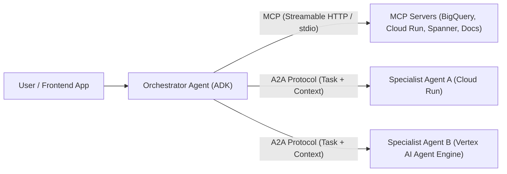

# Agentic Protocols: MCP & A2A

Modern agentic systems on Google Cloud rely on two complementary open standards:

1. **Model Context Protocol (MCP) — "The Hands" (Agent $\leftrightarrow$ Tools & Data):** Standardizes how an agent discovers and invokes deterministic tools, APIs, and database queries.
2. **Agent2Agent Protocol (A2A) — "The Social Layer" (Agent $\leftrightarrow$ Agent):** Standardizes how independent, opaque agents discover each other's capabilities via an **Agent Card** (`/.well-known/agent-card.json`) and collaborate across services, teams, or clouds ([https://github.com/a2aproject/A2A](https://github.com/a2aproject/A2A)).



---

## 1. Model Context Protocol (MCP) in ADK Agents

In [Google ADK 2.0](agent_development_kit_adk_and_skills.md), you connect your agent to any local (`stdio`) or remote (`StreamableHttpConnectionParams` on `/mcp`) MCP server using `McpToolset`:

```python
from google.adk.agents import LlmAgent
from google.adk.tools.mcp_tool import McpToolset, StreamableHTTPConnectionParams

# Connect an ADK agent to a remote MCP server hosted on Cloud Run or GCP
mcp_tools = McpToolset(
    connection_params=StreamableHTTPConnectionParams(
        url="https://my-mcp-server-xyz.a.run.app/mcp",
    )
)

root_agent = LlmAgent(
    name="cloud_ops_agent",
    model="gemini-3.8-flash",
    instruction="Use your MCP tools to inspect and manage cloud resources.",
    tools=[mcp_tools],
)
```

> [!IMPORTANT]
> **Always Use Streamable HTTP (`/mcp`) for Remote MCP Servers:** When deploying custom remote MCP servers on [Cloud Run](cloud_run_serverless_and_gpus.md) (e.g., with Python `FastMCP`), expose the **Streamable HTTP** transport (`mcp.run(transport="streamable-http")` at `/mcp`) rather than legacy SSE-only endpoints.

---

## 2. Agent2Agent (A2A) Protocol in ADK Agents

When your hackathon project splits work across multiple autonomous agents (for example, a customer-facing concierge agent delegating to a clinical vision agent or a financial risk agent deployed on a separate [Cloud Run](cloud_run_serverless_and_gpus.md) service or [Vertex AI Agent Engine](vertex_ai_agent_engine.md)):

### A. Exposing an ADK Agent as an A2A Server (`to_a2a`)
ADK can expose any `Agent` as an A2A-compliant service complete with an auto-generated `/.well-known/agent-card.json`:

```python
from google.adk.agents import LlmAgent
from google.adk.a2a.utils.agent_to_a2a import to_a2a

specialist_agent = LlmAgent(
    name="graphrag_specialist",
    model="gemini-3.8-flash",
    description="Answers complex multi-hop domain questions using Spanner Graph.",
    instruction="Answer multi-hop dependency queries concisely.",
)

# Creates an ASGI app exposing /.well-known/agent-card.json and A2A message endpoints
a2a_app = to_a2a(specialist_agent, port=8080)
```

### B. Consuming a Remote A2A Agent (`RemoteA2aAgent`)
```python
from google.adk.agents import LlmAgent
from google.adk.agents.remote_a2a_agent import RemoteA2aAgent

remote_specialist = RemoteA2aAgent(
    name="graphrag_specialist",
    description="Specialist agent for multi-hop graph queries.",
    agent_card="https://graphrag-specialist-xyz.a.run.app/.well-known/agent-card.json",
)

root_agent = LlmAgent(
    name="orchestrator",
    model="gemini-4-argon",
    instruction="Delegate multi-hop graph questions to graphrag_specialist.",
    sub_agents=[remote_specialist],
)
```

---

## Related Concepts

- [Google Cloud MCP Servers Catalog](gcp_mcp_servers_catalog.md) — Complete list of official Google Cloud Local & Remote MCP servers.
- [Agent Development Kit (ADK 2.0) & Official Skills](agent_development_kit_adk_and_skills.md) — Building multi-agent workflows and using `SkillToolset`.
- [Vertex AI Agent Engine (Managed Runtime)](vertex_ai_agent_engine.md) — Hosting A2A-enabled agents on managed Agent Runtime.
- [Cloud Run Serverless & GPUs](cloud_run_serverless_and_gpus.md) — Deploying remote MCP and A2A services with OIDC authentication.
